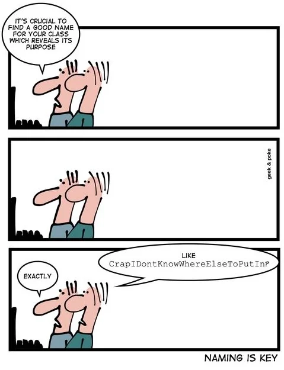
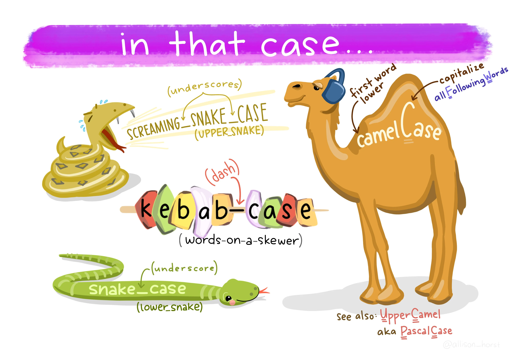

---
format:
  revealjs:
    css: style.css
    theme: simple
    revealjs-plugins:
      - a11y
    revealjs-a11y:
      # 0.2.3's menus introduce ARIA failures; retain our slide-menu handling.
      slide-menu-a11y: false
      menu: false
      # Use the extension's core accessibility fixes without extra UI/shortcuts.
      font-size-controls: false
      font-selection: false
      text-spacing: false
      transcript: false
      slide-change-cue: false
    slide-number: true
    code-line-numbers: false
    preview-links: auto
    keyboard: true
    touch: true
    help: true
    include-in-header: meta-tags.html
    include-after-body: accessibility.html
    link-external-newwindow: true
execute:
  echo: true
  eval: false
keywords: ["naming", "software-engineering", "computer-science", "software-development"]
description-meta: "A comprehensive guide to naming conventions and best practices for software development. Learn how to choose meaningful, consistent, and maintainable names for variables, functions, and classes."
license: "CC0 1.0 Universal"
pagetitle: "Dealing with the Second Hardest Thing in Computer Science"
author-meta: "Indrajeet Patil"
date-meta: "2025-12-05"
lang: "en"
dir: "ltr"
image: "media/social-media-card.webp"
image-alt: "Preview image for presentation about naming things in computer science"
canonical-url: "https://www.indrapatil.com/second-hardest-cs-thing/"
jupyter: python3
---

## Dealing with the Second Hardest Thing in Computer Science {style="margin-top: 2em; margin-bottom: 1em;"}

:::: {.columns}

::: {.column width="60%"}

::: {style="margin-top: 1em; margin-bottom: 1em;"}

::: {style="font-size: 0.9em; font-weight: bold;"}
Transforming Code Clarity Through Better Names
:::

::: {style="font-size: 0.8em; margin-top: 1em;"}
Indrajeet Patil
:::

:::

:::

::: {.column width="40%"}

{width="400" height="288" fig-alt="A cat sitting with confused expression, representing confusion about naming things"}

:::

::::

::: {style="text-align: center; font-size: 0.7em; margin-top: 2em; color: #666;"}
Source code for these slides can be found [on GitHub](https://github.com/IndrajeetPatil/second-hardest-cs-thing/){style="text-decoration: underline;"}.
:::

::: {.notes}
Welcome everyone to Dealing with the Second Hardest Thing in Computer Science.
Phil Karlton famously joked that there are only two hard problems in computer science: cache invalidation and naming things.
Today we will explore why naming is challenging and how to transform it from a hurried afterthought into a deliberate, repeatable software engineering practice.
:::

## What you'll learn today {.smaller}

- Why naming impacts code quality and maintainability
- Common naming pitfalls to avoid
- Practical strategies for clear, consistent, and meaningful names
- Tools and techniques for better naming (AI, code review)

::: {style="background-color: #FFFBC1; padding: 20px; border-radius: 25px; text-align: center;"}

🎯 **Goal**

Transform naming from an afterthought into a deliberate practice.

:::

<br>

::: {style="background-color: #e3f2fd; padding: 20px; border-radius: 25px; text-align: center;"}

Despite Python examples, all the mentioned strategies are **language-agnostic**.<br>
None of this advice is **dogma**; there can be valid reasons and conventions to break these rules.

:::

::: {.notes}
Review the presentation roadmap:
- Understand the cognitive bottlenecks that make naming difficult during active coding.
- Identify common naming pitfalls and anti-patterns that degrade codebase readability.
- Adopt practical heuristics for choosing clear, specific, and domain-appropriate names.
- Leverage developer tooling, code review, and generative AI as collaborative naming aids.
Emphasise that while examples are written in Python, all principles are language-agnostic guidelines rather than rigid dogma.
:::

# "There are only two hard things in Computer Science: cache invalidation and naming things." 
\- Phil Karlton

::: {.notes}
Reflect on Phil Karlton's classic quotation:
The quote resonates because cache invalidation is a classic algorithmic challenge, whereas naming is fundamentally a communication and abstraction challenge.
Good names bridge mechanical machine instructions with human mental models.
:::

# Why naming matters

:::: {.columns}

::: {.column width="50%"}

<div style="display: flex; align-items: center; height: 300px; font-size: 0.85em; color: #555; font-style: italic;">
Navigating the codebase with good names as beacons of clarity
</div>

:::

::: {.column width="50%"}

{width="350" height="350" fig-alt="A person navigating through an ocean of code, symbolizing the challenge of understanding codebases"}

:::

::::

::: {.notes}
Introduce Section 1: Why naming matters.
In any substantial software system, developers spend vastly more time reading, navigating, and comprehending existing code than writing new lines.
Clear names serve as beacons of clarity across an unfamiliar codebase.
:::

## Why naming is hard {.smaller}

Multiple cognitive demands exhaust mental capacity, leaving little for naming.

. . .

```{mermaid}
%%| eval: true
%%| echo: false
flowchart TD
    A[Programming Syntax] --> D[High Cognitive Load]
    B[Algorithmic Design] --> D
    C[Implementation Complexity] --> D
    
    D --> E[Quick Naming Decisions]
    
    E --> F[Generic Names]
    E --> G[Shortened Names]  
    E --> H[Context-Dependent Names]
    
    style A fill:#f8f9fa,color:#000
    style B fill:#f8f9fa,color:#000
    style C fill:#f8f9fa,color:#000
    style D fill:#fff3e0,color:#000
    style E fill:#ffebee,color:#000
    style F fill:#ffcdd2,color:#000
    style G fill:#ffcdd2,color:#000
    style H fill:#ffcdd2,color:#000
```

. . .

::: {style="background-color: #fff3e0; padding: 12px; border-radius: 8px; text-align: center; margin-top: 15px;"}
**Result**: Naming becomes reactive rather than deliberate
:::

::: {.notes}
Explain the cognitive load diagram:
When implementing functionality, working memory is occupied with language syntax, algorithmic logic, edge cases, and architectural constraints.
By the time a developer assigns a name, cognitive capacity is depleted, leading to rushed, generic, or overly terse identifiers.
:::

## The cost of poor naming {#section .smaller .sr-only-heading}

:::: {.columns}

::: {.column width="50%"}

::: {style="background-color: #ffebee; padding: 15px; border-radius: 10px; font-size: 0.9em;"}

::: {style="font-size: 1.3em; font-weight: bold; margin-bottom: 10px;"}
The hidden cost of poor naming
:::

*Immediate consequences:*

- Longer code reviews
- Debugging becomes detective work
- Extended onboarding

*Long-term impact:*

- Technical debt accumulation
- Higher bug introduction rates
- Risky refactoring

::: {style="background-color: #ffffff; padding: 10px; border-radius: 8px; margin-top: 10px; text-align: center;"}
*Poor naming spreads confusion throughout the entire system.*
:::

:::

:::

::: {.column width="50%"}

::: {style="background-color: #e8f5e9; padding: 15px; border-radius: 10px; font-size: 0.9em;"}

::: {style="font-size: 1.3em; font-weight: bold; margin-bottom: 10px;"}
Good names pay dividends
:::

*Development velocity:*

- Code reviews focus on logic
- Faster component targeting
- Confident feature development

*Maintenance benefits:*

- Safe and predictable refactoring
- Root cause fixes over symptom patches
- Self-documenting code

::: {style="background-color: #ffffff; padding: 10px; border-radius: 8px; margin-top: 10px; text-align: center;"}
*Time spent on naming is an investment with compound interest.*
:::

:::

:::

::::

::: {.notes}
Contrast the hidden costs of poor naming with the dividends of good naming:
- Costs: Code reviews slow down, debugging turns into guesswork, and technical debt compounds across teams.
- Dividends: Reviews focus on high-level logic, refactoring becomes predictable, and the codebase becomes largely self-documenting.
:::

# Naming: The Do's and Don'ts

> "_The beginning of wisdom is to call things by their proper name._" - Confucius

::: {.notes}
Introduce Section 2: Naming Do's and Don'ts.
Frame the section around Confucius's reflection that the beginning of wisdom is calling things by their proper name.
We will examine antipatterns to eliminate followed by positive patterns to adopt.
:::

# Core principle

::: {style="background-color: #FFFBC1; padding: 20px; border-radius: 25px; text-align: center; margin: 20px 0;"}

**Names must serve the *reader*, not the *author*, of code.**

Good names reveal intention and eliminate guesswork.

:::

::: {.notes}
Highlight the central thesis of the presentation:
Names must serve the reader, not the author.
When writing code, you possess maximum mental context; future readers, including yourself in six months, will have none of it.
:::

# The Don'ts

*Common pitfalls that make names harder to understand*

::: {.notes}
Introduce the Don'ts:
Examining common traps, ambiguities, and inconsistencies that needlessly drain mental energy during code navigation.
:::

## Avoid confusion and inconsistency {#section-1 .smaller .sr-only-heading}

::: {style="font-size: 0.65em;"}
| Tip | Why | Bad | Good |
|-----|-----|-----|------|
| <span style="background-color: #e3f2fd; color: #1565c0; padding: 4px 8px; border-radius: 4px; font-weight: bold;">**Confusion & Similarity**</span> |  |  |  |
| Avoid imprecise opposites | Can be [confusing](https://github.com/pomber/awesome-word-pairs) | `begin`/`last` | `begin`/`end` or `first`/`last` |
| Don't use hard-to-distinguish characters | Look identical with certain fonts | `count0`, `counto` | `count_zero`, `count_letter` |
| Don't use similar names for different meanings | Easily confused, need 2+ letter difference | `PatientRecs`, `PatientReps` | `PatientRecords`, `PatientReports` |
| Avoid naming entities with homonyms | Leads to confusion in discussion | `waste`, `waist` | `garbage`, `body_circumference` |
| Don't use easily confused names | Too similar, mistaken identity | `nn`, `nnn` | `n_square`, `n_cube` |
| Avoid ambiguous acronyms | Meaning varies by context | `NA` (North America vs Not Available) | `north_america`, `not_available` |
| <span style="background-color: #f3e5f5; color: #7b1fa2; padding: 4px 8px; border-radius: 4px; font-weight: bold;">**Consistency & Standards**</span> |  |  |  |
| Don't use inconsistent abbreviations | Choose one prefix and use consistently | `numColumns`, `noRows` | `numColumns`, `numRows` |
| Don't allow multiple English standards | Causes constant guessing | `centre`, `center` (mixed) | `center` (consistent) |
| Don't use misleading abbreviations | Conflicts with language conventions | `str` (for "structure") | `structure` |
| Avoid misleading names | Wrong info is worse than no info | `get_means()` (incorrectly implies precomputed) | `compute_means()` (correctly indicates computation) |
:::

::: {.notes}
Walk through the antipattern table:
- Avoid imprecise opposites (such as begin and last; prefer begin and end).
- Avoid visually ambiguous characters that look identical in common monospace fonts.
- Guard against homonyms and ambiguous abbreviations that cause friction during verbal discussions.
- Stick to consistent spelling conventions across the entire codebase.
:::

## Keep names clear and maintainable {#section-2 .smaller .sr-only-heading}

::: {style="font-size: 0.65em;"}
| Tip | Why | Bad | Good |
|-----|-----|-----|------|
| <span style="background-color: #e8f5e8; color: #2e7d32; padding: 4px 8px; border-radius: 4px; font-weight: bold;">**Communication & Clarity**</span> |  |  |  |
| Don't use pop-culture references | Not everyone knows them | `thats_what_she_said` | `female_birdsong_recording` |
| Don't use slang | Can't assume familiarity | `hit_the_road()` | `exit()` |
| Avoid unintended meanings | Check [Urban dictionary](https://www.urbandictionary.com/) | `dump()` | `export_data()` |
| Don't use uncommon English words | Stick to common parlance | `commence_process()` | `start_process()` |
| Don't use unpronounceable names | Enables easier verbal communication | `genymdhms()` | `generate_timestamp()` |
| Don't use region-specific terminology | Prefer international English | `lorry_capacity`, `boot_storage` | `truck_capacity`, `trunk_storage` |
| <span style="background-color: #fff3e0; color: #a64b00; padding: 4px 8px; border-radius: 4px; font-weight: bold;">**Technical & Maintainability**</span> |  |  |  |
| Don't misspell to save characters | Correct misspelling is harder to remember | `hilite` | `highlight` |
| Don't use commonly misspelled words | Slows you down, increases errors | `accumulate` variants | `sum`, `collect` |
| Don't use numeric suffixes for levels | Not informative | `level1`, `level2`, `level3` | `beginner`, `intermediate`, `advanced` |
| Don't use unsearchable names | Hard to find and replace | `a`, `f` | `arr`, `fun` |
| Don't prioritize grammar over clarity | Plural forms aid comprehension | `fish` (for multiple) | `fishes`, `peoples`, `feedbacks` |
:::

::: {.notes}
Examine clarity and technical maintainability:
- Avoid inside jokes, slang, pop-culture references, or obscure vocabulary that exclude teammates.
- Avoid unpronounceable shorthand: names should be easy to discuss aloud in standups and code reviews.
- Choose searchable identifiers; single-letter names defeat global search tools.
:::

# The Do's

*Actionable strategies for creating clear, maintainable names*

::: {.notes}
Transition to positive strategies:
Concrete, actionable rules for selecting names that communicate purpose and intent with minimal ambiguity.
:::

## Names should be self-documenting {.smaller}

Name quality correlates inversely with comment detail needed.

. . .

:::: {.columns}

::: {.column width='45%'}

Poor names require more comments:

```{python}
# function to convert temperature 
# from Fahrenheit to Celsius scale
# temp is the temperature in Fahrenheit
def unit_converter(temp: float):
    pass
```

:::

::: {.column width='55%'}

Good names are self-documenting:

```{python}
def fahrenheit_to_celsius(temp_fahrenheit: float):
    pass
```
<br>

:::

::::

. . .

::: {.callout-tip}

**Good names rarely require readers to read the documentation to understand what they represent.**

:::

::: {.notes}
Demonstrate the inverse relationship between naming quality and required commentary:
- The left example shows how generic names like unit_converter force developers to write explanatory comment blocks.
- The right example shows how fahrenheit_to_celsius communicates the contract instantly without needing comments.
:::

## Names should be specific {.smaller}

Generic names are widely used and acceptable in short-lived contexts. However, as scope and complexity increase, specific names become essential for clarity.

. . .

For longer loops, use meaningful names instead of `i`, `j`, `k`:

:::: {.columns}

::: {.column width='50%'}

```{python}
# abstruse
inventory[i][j]
```

:::

::: {.column width='50%'}

```{python}
# crystal clear
inventory[warehouse][product]
```

:::

::::

. . .

All variables are temporary. Calling one `tmp` invites carelessness.

:::: {.columns}

::: {.column width='50%'}

```{python}
# generic name
tmp = a + b
result = tmp * 2
```

:::

::: {.column width='50%'}

```{python}
# more descriptive
sum_values = a + b
result = sum_values * 2
```

:::

::::

. . .

::: {.callout-tip}

**Even when you *think* you need generic names, you are better off using more descriptive names.**

:::

::: {.callout-note title="Test function names should act as a comment"}

Unlike regular functions, long names are less problematic for test functions because they are not visible to users or called repeatedly throughout the codebase.

```python
# bad: test_retrieve_commands
# good: test_all_saved_commands_should_be_retrieved
```

:::

::: {.notes}
Discuss scope and specificity:
- Short loop variables like i and j are acceptable in brief, single-line scopes, but nested loops require descriptive indices like warehouse and product.
- Avoid calling variables tmp, which encourages careless accumulation of state.
- In test suites, descriptive function names serve as living specifications.
:::

## Names should be difficult to misinterpret {.smaller}

Try to misinterpret candidate names.

. . .

:::: {.columns}

::: {.column width='50%'}

```{.python code-line-numbers="1,3"}
# ambiguous - what kind of size?
def get_size(
    file_path: str,
) -> int:
    pass
```

How I interpret: <br>
*"File size in bytes on disk"*

:::

::: {.column width='50%'}

```{.python code-line-numbers="1,3"}
# clear - character count!
def get_character_count(
    file_path: str,
) -> int:
    pass
```

In reality: <br>
*"Number of characters in the file content"*

:::

::::

. . .

::: {.callout-tip}

**Precise and unambiguous names leave little room for misconstrual.**

:::

::: {.notes}
Encourage active misinterpretation when evaluating names:
Ask what else a candidate identifier could mean.
In the code example, get_size could represent bytes on disk or line count; get_character_count removes all ambiguity.
:::

## Names should be appropriately abstract {.smaller}

Find the right level of detail and domain focus—precise enough to be clear, concise enough to be readable, and focused on ***what*** rather than ***how***.

. . .

**Use context to eliminate redundancy:**

:::: {.columns}

::: {.column width='50%'}

```{python}
# redundant in context
Router.run_router()
BeerShelf.beer_count
```

:::

::: {.column width='50%'}

```{python}
# leverages context
Router.run()
BeerShelf.count
```

:::

::::

. . .

**Avoid encoding implementation details in names:**

:::: {.columns}

::: {.column width='50%'}

```{python}
# implementation details encoded
binary_search_users()
sql_query_products()
bonuses_pd  # pandas DataFrame
hash_map_cache
```

:::

::: {.column width='50%'}

```{python}
# implementation independent
find_user()
fetch_products()
bonuses
cache
```

:::

::::

. . .

**Find the precision sweet spot:**

```{python}
# too imprecise → okay → good → unnecessarily precise
d → days → days_since_last_accident → days_since_last_accident_floor_4_lab_23
```

. . .

::: {.callout-tip}

**Good names focus on purpose, include critical details, and remain meaningful across implementations.**

:::

::: {.notes}
Explain abstraction levels:
- Leverage enclosing context to eliminate redundancy (Router.run rather than Router.run_router).
- Avoid leaking underlying data structures into names (prefer find_user to binary_search_users).
- Balance detail to find the sweet spot between uninformative brevity and unwieldy verbosity.
:::

## Names should maintain standards {.smaller}

Standards **reduce cognitive burden** by enabling knowledge reuse across contexts.

. . .

**Avoid conflicting meanings and maintain consistency:**

:::: {.columns}

::: {.column width='50%'}

```{python}
# inconsistent - size means different things
size = len(x.encode('utf-8'))  # bytes
size = len(a)                  # elements

# inconsistent - different words, same concept
CreditCardAccount().retrieve_expenditure()
DebitCardAccount().fetch_expenditure()
```

:::

::: {.column width='50%'}

```{python}
# consistent - clear distinctions
byte_size = len(x.encode('utf-8'))
length = len(a)

# consistent - same word, same concept
CreditCardAccount().retrieve_expenditure()
DebitCardAccount().retrieve_expenditure()
```

:::

::::

. . .

**Follow language and domain conventions:**

:::: {.columns}

::: {.column width='50%'}

```{python}
# violates conventions
class playerEntity:
    self.HairColor = ""
```

:::

::: {.column width='50%'}

```{python}
# follows conventions
class PlayerEntity:
    self.hair_color = ""
```

:::

::::

. . .

**Use consistent prefixes for IDE tab completion:**

:::: {.columns}

::: {.column width='50%'}

```{python}
# bad - scattered when tab-completing
parse_json()
xml_reader()
csv_processor()
```

:::

::: {.column width='50%'}

```{python}
# good - groups related functions
parse_json()
parse_xml()
parse_csv()
```

:::

::::

. . .

::: {style="background-color: #FFFBC1; padding: 10px; margin: 10px; border-radius: 25px;text-align: center; font-size: 1.2rem;"}

**Following *a* standard consistently is more important than *which* standard you adopt.**

:::

::: {.notes}
Reinforce the value of consistent standards:
- Use consistent vocabulary across classes (do not mix retrieve_expenditure and fetch_expenditure for the same operation).
- Follow community and language naming conventions (PEP 8 casing).
- Use matching prefixes (parse_json, parse_xml, parse_csv) to enable efficient IDE tab completion.
:::

## Keep important details and remove redundancy {#section-3 .smaller .sr-only-heading}

### Unnecessary details in names should be removed...

:::: {.columns}

::: {.column width='50%'}

```{python}
# okay
convert_to_string()
file_object
str_name  # Hungarian notation
```

:::

::: {.column width='50%'}

```{python}
# better
to_string()
file
name
```

:::

::::

:::{.callout-note title="Avoid redundancy"}

- In type names, avoid using *class*, *data*, *object*, and *type* (e.g. bad: `classShape`, good: `Shape`)
- In function names, avoid using *be*, *do*, *perform*, etc. (e.g. bad: `doAddition()`, good: `add()`)

:::

### **but** important details should be kept!

:::: {.columns}

::: {.column width='50%'}

```{python}
# okay
child_height
password
id
address
```

:::

::: {.column width='50%'}

```{python}
# better
child_height_cm
plaintext_password
hex_id
ip_address
```

:::

::::

::: {.callout-tip}

**If some information is critical to know, it should be part of the name.**

:::

::: {.notes}
Distinguish unnecessary noise from critical domain qualifiers:
- Remove redundant type markers and boilerplate verbs like doAddition or classShape.
- Retain essential units, encodings, and qualifiers such as child_height_cm, plaintext_password, and ip_address.
:::

## Boolean names should be clear {.smaller}

Names for Boolean variables or functions should make clear what true and false mean. This can be done using prefixes (**is**, **has**, **can**, etc.).

:::: {.columns}

::: {.column width='50%'}

```{python}
# not great
if child:
    if parent_supervision:
        watch_horror_movie = True
```

:::

::: {.column width='50%'}

```{python}
# better
if is_child:
    if has_parent_supervision:
        can_watch_horror_movie = True
```

:::

::::

. . .

In general, use positive terms for Booleans since they are easier to process.

:::: {.columns}

::: {.column width='50%'}

```{python}
# double negation - difficult
is_firewall_disabled = False
```

:::

::: {.column width='50%'}

```{python}
# better
is_firewall_enabled = True
```

:::

However, if the variable is primarily used in its false state (e.g., `is_volcano_inactive`), the negative version can be easier to work with.

::::

. . .

::: {.callout-tip}

**Boolean variable names should convey what true or false values represent.**

:::

::: {.notes}
Discuss Boolean naming conventions:
- Use standard predicate prefixes such as is_, has_, and can_ to signal Boolean types clearly.
- Favour positive phrasing (is_firewall_enabled) over double negatives (not is_firewall_disabled) to minimise cognitive strain during conditional evaluation.
:::

## Choose domain-appropriate names {.smaller}

Select terminology that matches your context: computer science terms for technical concepts, problem domain terms for business logic.

:::: {.columns}

::: {.column width='80%'}

**Use computer science terms for technical concepts:**

:::: {.columns}

::: {.column width='40%'}

```{python}
# vague business language
process_items_sequentially()
store_thing_temporarily()
```

:::

::: {.column width='40%'}

```{python}
# precise CS terminology
traverse_list()
push_to_stack()
```

:::

::::

**Use problem domain terms for business concepts:**

:::: {.columns}

::: {.column width='40%'}

```{python}
# generic technical terms
validate_input_data()
process_financial_records()
```

:::

::: {.column width='40%'}

```{python}
# domain-specific terms
validate_loan_application()
calculate_mortgage_payment()
```

:::

::::

:::

::: {.column width='20%'}

```{mermaid}
%%| eval: true
%%| echo: false
flowchart TD
    Title["Layered Architecture"]
    UI["Presentation<br/>(Controllers)"]
    BL["Business Logic<br/>(Services)"]
    DA["Data Access<br/>(Repository)"]
    
    Title -.-> UI
    UI --> BL
    BL --> DA
    
    style Title fill:none,stroke:none,color:#666
    style UI fill:#e3f2fd,color:#000
    style BL fill:#fff3e0,color:#000
    style DA fill:#f3e5f5,color:#000
```

:::

::::

::: {.notes}
Align terminology with architectural layers:
- Use computer science terminology for lower-level infrastructure, algorithms, and data structures (traverse_list, push_to_stack).
- Use business domain terminology for domain entities and services (validate_loan_application, calculate_mortgage_payment).
:::

## Use appropriate grammatical forms {.smaller}

Follow consistent patterns: nouns for entities and data, verbs for actions.

. . .

**Classes and objects should use nouns:**

:::: {.columns}

::: {.column width='50%'}

```{python}
# verb-based - confusing
class ProcessPayment:
    pass

class HandleError:
    pass
```

:::

::: {.column width='50%'}

```{python}
# noun-based - clear
class PaymentProcessor:
    pass

class ErrorHandler:
    pass
```

:::

::::

::: {style="background-color: #e8f5e8; padding: 10px; border-radius: 8px; text-align: center; margin: 15px 0;"}
Class represents a concept and should use singular nouns (e.g. `User` and not `Users`).
:::

. . .

**Methods that return values use nouns, action methods use verbs:**

:::: {.columns}

::: {.column width='50%'}

```{python}
# inconsistent grammar
user.get_name()     # returns name
user.save()         # performs action
user.validate_age() # returns boolean
```

:::

::: {.column width='50%'}

```{python}
# consistent grammar
user.name()         # returns name
user.save()         # performs action
user.is_adult()     # returns boolean
```

:::

::::

. . .

::: {.callout-tip}

**Grammatical consistency helps readers predict what methods do without reading documentation.**

:::

::: {.notes}
Outline grammatical conventions:
- Classes and objects represent conceptual entities and should be singular nouns (PaymentProcessor, ErrorHandler).
- Methods that perform actions should use verbs (user.save()), while methods that return values or inspect state should use nouns or predicates (user.name(), user.is_adult()).
:::

# Utilizing tools

::: {.notes}
Introduce Section 3: Tooling and collaboration.
Examine how linters, generative AI, code reviews, and refactoring tools support developers in maintaining naming quality.
:::

## Naming limitations of linters {.smaller}

:::: {.columns}

::: {.column width='50%' .fragment}

**What they <span style="background-color: #c8e6c9; padding: 2px 6px; border-radius: 4px;">CAN</span> do:**

- Enforce naming conventions
- Check for reserved keywords
- Detect naming pattern violations
- Flag overly short or long names
- Ensure consistent formatting

:::

::: {.column width='50%' .fragment}

**What they <span style="background-color: #ffcdd2; padding: 2px 6px; border-radius: 4px;">CANNOT</span> do:**

- Understand the intent behind your code
- Suggest meaningful names based on context
- Assess whether names represent what entities do
- Determine problem domain consistency
- Evaluate clarity for future developers

:::

::::

. . .

::: {.callout-note title="The fundamental limitation"}

**Linters can enforce *syntax* but not *semantics*.** Good naming requires human understanding of both the problem and the solution.

:::

::: {.notes}
Delineate what static linters can and cannot accomplish:
- Linters excel at enforcing structural rules, checking casing patterns, and detecting reserved keywords.
- However, linters check syntax, not semantics: they cannot understand intent, judge domain accuracy, or assess readability for human colleagues.
:::

## Generative AI tools can be valuable allies {.smaller}

:::: {.columns}

::: {.column width='60%'}

**Why AI tools can help:**

- Full context understanding of functions/classes
- Inconsistency detection across codebase
- Multiple naming suggestions with rationales

::: {style="background-color: rgba(117, 112, 179, 0.15); border-left: 5px solid #7570B3FF; padding: 15px; border-radius: 8px; margin-top: 20px;"}

**LLM-Generated Names**

LLMs can suggest overly verbose names or miss domain context, but they can also improve unclear ones. <small>Example: `process_data(x)` -> `calculate_average(sales_data)`</small>

::: {style="background-color: #ffffff; text-align: center; font-size: 1.2em; margin-top: 10px;"}

*Always review LLM-generated names critically.*

:::

:::

:::

::: {.column width='40%'}

```{mermaid}
%%| eval: true
%%| echo: false
flowchart TD
    H[Human] -.->|Collaborates| A[AI]
    A -.->|Feedback| H
    A --> L[Linter]
    L -->|Approves| S[Standardised Names]

    style H fill:#e3f2fd,color:#000
    style A fill:#f3e5f5,color:#000
    style L fill:#fff3e0,color:#000
    style S fill:#e8f5e8,color:#000
```

:::

::::

::: {.notes}
Evaluate generative AI assistants as naming partners:
LLMs have broad contextual visibility across functions and can propose multiple alternative names with rationales.
However, AI suggestions must be reviewed critically to avoid overly verbose names or subtle domain mismatches.
:::

## Code Review: A fresh perspective {.smaller}

Lower cognitive load + fresh perspective = ideal conditions for better naming.

. . .

```{mermaid}
%%| eval: true
%%| echo: false
flowchart TD
    A[Code Review] --> B[Lower Cognitive Load]
    B --> C[Fresh Perspective]
    B --> D[Focus on Clarity]
    
    C --> E[Question Assumptions]
    C --> F[Spot Unclear Names]
    D --> G[Evaluate Intent]
    D --> H[Assess Abstractions]
    
    E --> I[Better Names]
    F --> I
    G --> I
    H --> I
    
    style A fill:#e3f2fd,color:#000
    style B fill:#f3e5f5,color:#000
    style C fill:#f8f9fa,color:#000
    style D fill:#f8f9fa,color:#000
    style E fill:#fff3e0,color:#000
    style F fill:#fff3e0,color:#000
    style G fill:#fff3e0,color:#000
    style H fill:#fff3e0,color:#000
    style I fill:#e8f5e8,color:#000
```

::: {.notes}
Highlight code review as an ideal naming checkpoint:
Reviewers operate under significantly lower cognitive load than the original author, allowing them to spot confusing names, question implicit assumptions, and suggest clearer alternatives.
:::

## Renaming in legacy code {.smaller}

Improving names in existing codebases requires careful strategy to avoid breaking changes.

. . .

**Safe refactoring approaches:**

:::: {.columns}

::: {.column width='50%'}

```{python}
# Step 1: Add new name with deprecation
@deprecated("Use calculate_total() instead")
def calc_tot(items):
    return calculate_total(items)

def calculate_total(items):
    # implementation
    pass
```

:::

::: {.column width='50%'}

```{python}
# Step 2: Update all internal calls
# Use IDE refactoring tools:
# - "Find All References"
# - "Rename Symbol"
# Commit after each successful rename
```

:::

::::

. . .

::: {style="background-color: #fff3e0; padding: 15px; border-radius: 10px; margin: 10px 0; font-size: 0.75em;"}

**Version control best practices:**

- Create feature branch for naming changes
- Make one logical naming change per commit
- Use descriptive commit messages: `"Rename calc_tot to calculate_total"`
- Run full test suite after each rename

:::

::: {.notes}
Walk through safe legacy refactoring workflows:
- Use deprecation decorators to maintain backwards compatibility when updating public APIs.
- Use IDE refactoring capabilities (Rename Symbol) rather than blunt global search-and-replace.
- Isolate renames into dedicated commits covered by comprehensive automated tests.
:::

# Benefits of good names

> "_In your name I will hope, for your name is good._" 
- Psalms 52:9

::: {.notes}
Introduce Section 4: The long-term return on investment.
Reflect on how deliberate naming choices elevate code quality, developer velocity, and software longevity.
:::

## Benefits for development, design, and collaboration {#section-4 .smaller .sr-only-heading}

:::: {.columns}

::: {.column width="60%"}

::: {style="background-color: #e3f2fd; padding: 15px; border-radius: 10px; margin: 10px 0; font-size: 0.75em;"}

**For development velocity:**

- Easier reading and faster comprehension
- Reduced need for documentation
- Confident feature development without fear

:::

::: {style="background-color: #f3e5f5; padding: 15px; border-radius: 10px; margin: 10px 0; font-size: 0.75em;"}

**For design quality:**

- Forces focus on bigger picture and thoughtful design
- Improves your own understanding through clarity-seeking
- Reduces ambiguities and bugs

:::

::: {style="background-color: #e8f5e9; padding: 15px; border-radius: 10px; margin: 10px 0; font-size: 0.75em;"}

**For team collaboration:**

- Reduces cognitive overload across the team
- Makes code more maintainable for future developers
- Enables effective knowledge transfer

:::

:::

::: {.column width="30%"}

{width="100%" height="500" fig-alt="A comic showing the importance of naming in programming"}

::: {style="text-align: center; font-size: 0.8em; margin-top: 2px;"}
Source: Geek & Poke
:::

:::

::::

::: {.notes}
Summarise benefits across three core dimensions:
- Development velocity: Faster comprehension and less time spent deciphering intent.
- Design quality: Clear names force modular thinking and reveal architectural flaws early.
- Team collaboration: Lower collective onboarding overhead and reduced misunderstandings.
:::

## Naming is hard, but worth it

Invest time in good names early—they pay dividends by reducing system complexity.

**The more you do it, the easier it will get!**

<br>

::: {style="background-color: #FFFBC1; padding: 20px; border-radius: 25px;text-align: center;"}

"_Using understandable names is a foundational step to producing quality software._" - Al Sweigart

:::

::: {.notes}
Offer concluding encouragement:
Naming is a craft that improves steadily with deliberate practice.
Investing a few extra minutes in choosing the right identifier pays compound interest throughout the lifespan of the software.
:::

# Thank You

And Happy Naming! 😊

<br>
<br>

::: {style="text-align: center; font-size: 0.7em;"}

Check out my other [slide decks](https://www.indrapatil.com/presentations/) on software development best practices

:::

::: {style="text-align: center; font-size: 1em;"}

<a class="deck-icon-link" href="https://www.linkedin.com/in/indrajeet-patil-ph-d-397865174/" aria-label="LinkedIn"><span class="deck-icon deck-icon-brands-linkedin" aria-hidden="true"></span></a>
&nbsp;&nbsp;
<a class="deck-icon-link" href="http://github.com/IndrajeetPatil" aria-label="GitHub"><span class="deck-icon deck-icon-brands-github" aria-hidden="true"></span></a>
&nbsp;&nbsp;
<a class="deck-icon-link" href="mailto:patilindrajeet.science@gmail.com" aria-label="Email"><span class="deck-icon deck-icon-solid-envelope" aria-hidden="true"></span></a>

:::

::: {.notes}
Thank the audience for their time and attention.
Invite questions, reflections, and personal naming experiences from the audience.
:::

## References {.smaller data-visibility="uncounted"}

:::{style="font-size: 25px;"}

- McConnell, S. (2004). *Code Complete* (2nd ed.). Microsoft Press. (**pp. 259-290**)

- Boswell, D., & Foucher, T. (2011). *The Art of Readable Code*. O'Reilly Media, Inc. (**pp. 7-31**)

- Martin, R. C. (2009). *Clean Code*. Pearson Education. (**pp. 17-52**)

- Hermans, F. (2021). *The Programmer's Brain*. Manning Publications. (**pp. 127-146**)

- Ousterhout, J. K. (2018). *A Philosophy of Software Design*. Yaknyam Press. (**pp. 121-129**)

- Goodliffe, P. (2007). *Code Craft*.  No Starch Press. (**pp. 39-56**)

- Padolsey, J. (2020). *Clean Code in JavaScript*. Packt Publishing. (**pp. 93-111**)

- Contieri, M. (2023). *Clean Code Cookbook*. O'Reilly Media, Inc. (**pp. 89-110**)

- Zimmerman, C. (2024). *The Rules of Programming*. O'Reilly Media, Inc. (**pp. 31-42**)

- [Ottinger's Rules for Variable and Class Naming](https://exelearning.org/wiki/OttingersNaming/)

- For a good example of organizational naming guidelines, see [Google C++ Style Guide](https://google.github.io/styleguide/cppguide.html#Naming).

:::

::: {.notes}
Acknowledge key software craftsmanship literature that shaped these principles, including McConnell's Code Complete, Boswell and Foucher's The Art of Readable Code, and Martin's Clean Code.
:::

## Popular Naming Conventions {.smaller data-visibility="uncounted"}

:::{style="font-size: 0.7em;"}

Various domains have established naming conventions that provide consistency and clarity:

- **[BEM (Block Element Modifier)](http://getbem.com/)** - CSS class naming methodology

- **[REST API Naming Conventions](https://restfulapi.net/resource-naming/)** - Guidelines for RESTful resource naming

- **[PEP 8](https://pep8.org/#naming-conventions)** - Python naming conventions

- **[Google Java Style Guide](https://google.github.io/styleguide/javaguide.html#s5-naming)** - Java naming conventions

- **[Rust Naming Conventions](https://rust-lang.github.io/api-guidelines/naming.html)** - Rust API naming guidelines

- **[Go Code Review Comments](https://go.dev/wiki/CodeReviewComments#variable-names)** - Go naming best practices

- **[Kubernetes Resource Naming](https://kubernetes.io/docs/concepts/overview/working-with-objects/names/)** - Cloud-native resource naming

- **[Database Naming Conventions](https://www.sqlstyle.guide/#naming-conventions)** - SQL table and column naming

- **[Microsoft .NET Naming Guidelines](https://learn.microsoft.com/en-us/dotnet/standard/design-guidelines/naming-guidelines)** - .NET framework naming conventions

- **[Ruby Style Guide](https://rubystyle.guide/#naming-conventions)** - Ruby naming conventions

:::

::: {.notes}
Provide reference pointers to widely adopted industry style guides, including PEP 8, the Google Java and C++ style guides, and Rust API naming guidelines.
:::

## *Extra* : Examples of Conventions {.smaller data-visibility="uncounted" style="background-color: #f8f9fa; padding: 15px; border-radius: 10px; border-left: 4px solid #6c757d;"}

::: {style="font-size: 0.55em; line-height: 1.3;"}

::: {style="background-color: #e3f2fd; padding: 12px; border-radius: 8px; margin-bottom: 15px;"}
**Programming Language specific**

| Language | Variables | Functions | Classes | Constants |
|----------|-----------|-----------|---------|-----------|
| **Scala** | `camelCase` | `camelCase` | `PascalCase` | `UPPER_SNAKE_CASE` |
| **Kotlin** | `camelCase` | `camelCase` | `PascalCase` | `UPPER_SNAKE_CASE` |
| **Rust** | `snake_case` | `snake_case` | `PascalCase` | `SCREAMING_SNAKE_CASE` |
| **Swift** | `camelCase` | `camelCase` | `PascalCase` | `camelCase` |
| **Elixir** | `snake_case` | `snake_case` | `PascalCase` | `@upper_snake_case` |
:::

::: {style="background-color: #f3e5f5; padding: 12px; border-radius: 8px; margin-bottom: 15px;"}
**Technology Stack specific**

| Layer | Convention | Examples |
|-------|------------|----------|
| **Database** | `snake_case` | `user_profiles`, `created_at` |
| **REST APIs** | `kebab-case`/`snake_case` | `/user-profiles`, `user_name` |
| **GraphQL** | `camelCase` | `userProfile`, `orderItems` |
| **CSS/HTML** | `kebab-case` | `.nav-menu`, `#main-content` |
| **DevOps** | `kebab-case` | `my-app-deployment` |
| **URLs/Routes** | `kebab-case` | `/api/user-accounts`, `/admin/user-settings` |
| **Event Names** | `camelCase`/`kebab-case` | `userSignedIn`, `order-completed` |
:::

::: {style="margin-top: 15px; padding: 8px; background-color: rgba(108, 117, 125, 0.1); border-radius: 6px; text-align: center; font-size: 1.1em;"}
**Consistency within each layer matters more than uniformity across layers**
:::

:::

::: {.notes}
Review layer-specific naming conventions across languages and full-stack layers (databases, REST APIs, GraphQL, and CSS).
Remind presenters that internal consistency within a layer matters more than cross-layer uniformity.
:::

## ICYMI: Available casing conventions {.smaller data-visibility="uncounted"}

There are various casing conventions used for software development.

{fig-align="center" fig-alt="An illustration showing casing conventions used for software development."}

:::{style="text-align: center; font-size: 0.9rem;"}

Illustration (CC-BY) by [Allison Horst](https://allisonhorst.com/)

:::

::: {.notes}
Conclude with Allison Horst's visual overview of casing conventions, providing an accessible reference for snake_case, camelCase, PascalCase, and kebab-case.
:::
